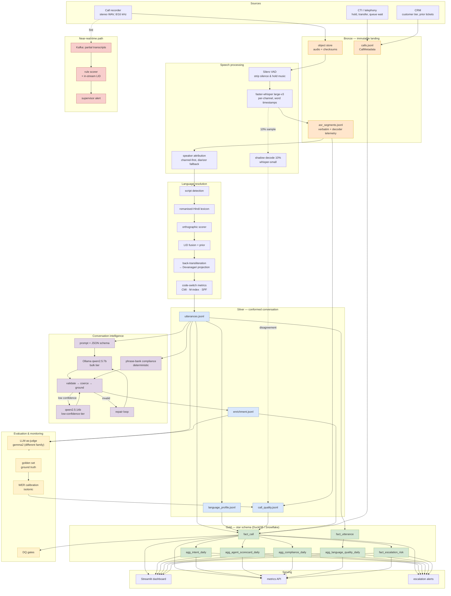

# Architecture

## End-to-end



## The three ideas the design rests on

**1. Language is resolved before meaning is extracted.**
Most speech-analytics stacks treat language as an ASR side-effect. In an Indian
contact centre that is the root cause of nearly every downstream defect: Whisper
labels romanised Hindi as English roughly three times in four, and from that point
on the utterance is scored by English sentiment lexicons, matched against English
compliance phrases, and routed to an English intent classifier. So language
resolution is its own layer with its own tests, sitting between ASR and every
consumer, and it produces a *Devanagari projection* that gives Hindi content one
canonical form regardless of the script it arrived in.

**2. Deterministic where it must be auditable; LLM where it must be flexible.**
Compliance detection is deterministic first — a multilingual phrase bank an
auditor can read, with the LLM used only to adjudicate. Intent, sentiment and
resolution are LLM-native, because enumerating those rules is hopeless. Where the
two disagree on compliance, the disagreement is *published* and queued for human
review rather than silently resolved. An automated compliance failure on a
disputed detection destroys trust in the whole scorecard.

**3. Quality is a first-class column, not a footnote.**
Every Silver row carries an ASR confidence and quality flags; every call carries a
calibrated WER estimate and a band; `fact_call.is_kpi_eligible` gates every
aggregate. The share of excluded volume is itself published, so the filter can
never hide silently. This is what makes it defensible to put an AHT number in
front of an operations director.

## Technology choices and why

| Layer | Choice | Rationale | What I rejected |
|---|---|---|---|
| ASR | **faster-whisper large-v3**, CTranslate2, int8 | 4× faster than reference Whisper at equal WER; word timestamps give us confidence for free; runs on commodity GPU | Whisper API (per-minute cost at our volume, data residency); wav2vec2 (worse on code-switching); Google STT (good Hindi, poor Hinglish, cost) |
| ASR alt. | IndicWhisper / AI4Bharat as A/B | Better on Indic monolingual, weaker on English spans — worth measuring per queue, not adopting blindly | — |
| VAD | **Silero** (bundled) | Call audio is 30–60% silence/hold music; removing it cuts GPU spend proportionally *and* suppresses Whisper's hallucination-over-silence failure | WebRTC VAD (worse on noisy mobile audio) |
| Diarization | **Channel separation**, pyannote only for mono | Stereo attribution is exact and free. Running a diarizer over stereo is choosing a worse answer for no reason | pyannote everywhere (unnecessary error + GPU cost) |
| LID | **Custom cascade** (script → lexicon → orthography → context), fused with decoder prior | Off-the-shelf LID is trained on script statistics and cannot see romanised Hindi. A 300-entry domain lexicon fixes the head of the distribution for zero inference cost | fastText lid.176, CLD3 (both fail the exact case that matters) |
| Transliteration | Rule-based + lexicon, **IndicXlit** in production | Deterministic path for tests and the common cases; a trained model for the long tail | Translation to English (destroys the code-switch signal we need) |
| LLM | **Ollama, qwen2.5 7B/14B, local** | DPDP data residency without a legal review; cost is GPU-hours we control; no quota ceiling on backfills; strong multilingual for its size | Hosted frontier APIs — better reasoning, but PII egress, per-token cost at volume, and rate limits on reprocessing. The `LlmBackend` interface makes this a one-class swap if the accuracy gap proves material |
| Structured output | **Constrained decoding** (Ollama `format` + JSON Schema) | Prose instructions to emit valid JSON fail on 7B models; schema-constrained generation does not | Prompt-only JSON, regex extraction |
| Embeddings | **bge-m3** | Genuinely multilingual — an English query retrieves a Hindi disclosure, which is exactly what compliance similarity needs | English-only encoders; OpenAI embeddings (egress again) |
| Warehouse | **DuckDB** local → Snowflake/BigQuery at scale | At demo scale DuckDB is the right answer, not a compromise: reads Silver files directly, no cluster, same ANSI SQL. Only five staging views are dialect-specific | Postgres (poor analytical scans); Spark (operationally heavy for this volume) |
| Orchestration | **Airflow** | Partition-scoped backfill is the whole job, and Airflow's backfill semantics + pools for GPU/LLM contention fit exactly | Dagster (better asset model, smaller talent pool in Bengaluru); cron (no backfill, no lineage) |
| Streaming | **Kafka** | Replay for tuning against recorded traffic, key-ordered partitions, multiple independent consumers | SQS/PubSub (no replay, no ordering guarantee we need) |
| Dashboard | **Streamlit** | Python-native, same models as the pipeline, hours not weeks | React (better UX, 10× the effort for an internal tool); Metabase/Superset (fine for tables, poor for the transcript explorer and language ribbon) |

## Cloud deployment

Reference target is **AWS in `ap-south-1` (Mumbai)** — DPDP-aligned data
residency and the lowest latency to Indian telephony providers.

```
Recorder ──► S3 (raw audio, SSE-KMS, Object Lock)
                │
                ├─► EventBridge ─► SQS ─► ECS Fargate (ingest, metadata)
                │
                └─► Batch on EC2 g5.xlarge Spot (ASR)
                       │  auto-scaling on queue depth, checkpointed per call
                       ▼
                  S3 (Bronze/Silver, Parquet, dt-partitioned)
                       │
                       ├─► EKS: Ollama on g5.2xlarge (enrichment, node autoscaled to zero)
                       │
                       └─► Athena / Snowflake external tables ─► Gold
                                                                  │
                                                    ECS Fargate (Streamlit) + ALB
```

Key choices: **Spot for ASR** (checkpointing per call makes interruption cheap —
this is the single largest cost lever, roughly 70% off on-demand); **scale-to-zero
for the LLM nodes** (nightly batch does not justify a always-on GPU);
**Parquet + partition pruning** in Gold; **S3 lifecycle** moving audio to Glacier
Instant Retrieval after 90 days while transcripts stay hot indefinitely — the
transcripts are what analytics reads, and they are ~0.1% of the audio's size.
