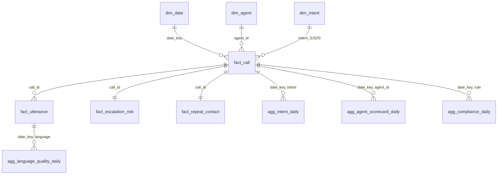

# Data model

## Layer contract

| Layer | Contains | Written by | Rebuild cost | Rebuild trigger |
|---|---|---|---|---|
| **Bronze** | Raw audio, CTI metadata, verbatim ASR + decoder telemetry | Ingest, ASR | Expensive (GPU) | New ASR model only |
| **Silver** | Speaker turns, normalised text, resolved language, code-switch metrics, LLM enrichment, quality estimates | Silver build, enrichment | Cheap (rules) / moderate (LLM) | Lexicon change, prompt change, taxonomy change |
| **Gold** | Star schema, aggregates, escalation scores | SQL | Seconds | Any Silver change, KPI change |

The boundary that matters: **a prompt change must not re-run ASR.** Prompt changes
are frequent, ASR changes are rare. Re-running a six-hour GPU job because someone
edited a prompt is how a team stops iterating.

Bronze is append-only and replayable; Silver and Gold are derived and disposable.

## Bronze

### `bronze.calls` — one row per call

| Column | Type | Note |
|---|---|---|
| `call_id` | string PK | |
| `tenant_id` | string | multi-tenant partition key |
| `audio_uri`, `audio_sha256` | string | checksum proves we processed what we landed |
| `duration_ms`, `sample_rate_hz`, `channels` | int | `channels=2` is the accuracy-critical one |
| `recorded_at`, `ingested_at`, `ingest_batch_id` | ts / string | partition on `recorded_at`, not ingest time |
| `agent_id`, `agent_name`, `queue`, `campaign`, `direction` | string | |
| `customer_id_hash` | string(64) | **SHA-256 + tenant salt. Raw MSISDN never enters the lake.** DQ blocks on length ≠ 64 |
| `customer_city`, `customer_state` | string | enables regional quality slicing |
| `hold_count`, `hold_total_ms`, `transfer_count`, `queue_wait_ms`, `disconnect_party` | int / string | telephony truth — never re-derived from audio |

### `bronze.asr_segments` — one row per decoder segment

Verbatim, deliberately uncleaned, so any Silver utterance traces back to the raw
hypothesis. Carries `avg_logprob`, `no_speech_prob`, `compression_ratio`,
`temperature`, `whisper_lang`, `whisper_lang_prob`, and a `words[]` array of
`{word, start_ms, end_ms, probability}`.

Those telemetry fields are not diagnostics — they are the **input to
ground-truth-free quality estimation**. Dropping them to save space forfeits the
ability to know whether any of the analytics is trustworthy.

## Silver

### `silver.utterances` — one row per speaker turn

Beyond the obvious (`speaker_role`, `start_ms`, `text_raw`):

| Column | Why it exists |
|---|---|
| `text_normalized` | conservative normalisation; the analysis surface |
| `text_devanagari` | **the Devanagari projection** — one canonical form for Hindi regardless of input script |
| `lang_primary`, `lang_confidence`, `lang_distribution` | resolved language + full posterior |
| `token_langs[]` | per-token `{token, lang, confidence, is_transliterated}` — what makes code-switch metrics possible |
| `is_code_switched`, `cmi`, `switch_points` | mixing measurement |
| `asr_confidence` | fused decoder signals, 0–1 |
| `quality_flags[]` | `low_asr_confidence`, `hallucination_suspect`, `overlapped_speech`, `speaker_flip_repaired`, … |
| `diarization_confidence`, `overlapped_with_next` | attribution reliability |

`quality_flags` is a string array, not an enum, on purpose: the list grows often
and a new flag must not require a schema migration.

### `silver.call_enrichment` — one row per call

The LLM output contract. Design rules, enforced in
[`models/enrichment.py`](../src/ccma/models/enrichment.py):

1. `extra="forbid"` everywhere — a hallucinated key fails loudly rather than
   being silently dropped.
2. Every categorical field is an enum — the model cannot invent an intent.
3. Every subjective field has a sibling `confidence` — consumers threshold
   rather than trust.
4. **Every extracted claim carries `evidence_turn_indices`.** An assertion with
   no pointer into the transcript is unverifiable and is rejected in validation.
   This is what makes hallucination machine-detectable.

Plus lineage on every row: `llm_model`, `prompt_version`, `schema_version`,
`validation_status`, `validation_errors`, `repair_attempts`, `latency_ms`. When a
metric shifts, the first question is "did the prompt change?", and that must be
answerable with SQL.

### `silver.call_quality`, `silver.language_profile`

Reference-free WER estimate with interval and band; call-level language shares,
CMI, M-index, switch-point fraction, agent/customer language match.

## Gold

Star schema, [`gold/gold.sql`](../src/ccma/gold/gold.sql).



### `fact_call` — the conformed grain

One row per call, joining CTI metadata, utterance aggregates, language profile,
enrichment, compliance rollup and quality estimate. Everything else in Gold
derives from it, which is what keeps "AHT" meaning one thing.

The column that matters most:

```sql
is_kpi_eligible =
      quality_band IN ('GOOD','FAIR')
  AND validation_status <> 'QUARANTINED'
  AND turn_count >= 3
  AND agent_talk_ms > 0
  AND customer_talk_ms > 0
```

Every aggregate filters on it. `agg_quality_daily` publishes how much volume it
excluded and why, so the filter can never hide silently. A KPI computed over
unusable transcripts is worse than a missing KPI, because someone will act on it.

### Aggregates

| Table | Grain | Answers |
|---|---|---|
| `agg_intent_daily` | date × L1 × L2 | intent distribution, AHT/FCR/escalation by intent |
| `agg_volume_daily` | date × queue × language × direction | volume trends, audio hours |
| `agg_agent_scorecard_daily` | date × agent | AHT, FCR, compliance, talk ratio, **language match** |
| `agg_compliance_daily` | date × queue × rule | adherence, violations, disputed count |
| `agg_language_quality_daily` | date × language | **per-language ASR quality — the multilingual monitoring surface** |
| `agg_quality_daily` | date | the honesty table: how much data each stage discarded |
| `agg_sentiment_daily` | date × queue × intent | sentiment delta, negative close rate |
| `fact_repeat_contact` | call | 7-day repeat window, both directions |
| `fact_escalation_risk` | call | rule score, model score, band, drivers |

### Claimed vs measured FCR

`fcr_candidate` is the LLM's reading of the conversation — a hypothesis.
`vw_fcr_measured` is the verdict: claimed FCR **not** followed by a repeat contact
on the same L1 intent within 7 days. Both are published side by side; the gap
between them is a direct measure of how optimistic the model is, and it is one of
the more useful numbers in the system.

The cost is a 7-day settling window, so the most recent week is always
provisional and the dashboard must render it as such.

## Retention & privacy

| Data | Retention | Rationale |
|---|---|---|
| Raw audio | 90 days hot → Glacier IR to 1 year | Dispute resolution; audio is ~1000× transcript size |
| Bronze ASR segments | 2 years | Enables Silver replay without re-decoding |
| Silver / Gold | 3 years | Trend analysis |
| `customer_id_hash` | with the row | Never reversible; salt held in KMS |
| PII in transcripts | redacted at Silver | Card numbers, Aadhaar, OTPs masked before enrichment |

The `NO_FULL_CARD_READBACK` compliance rule doubles as a PII detector: it flags
calls where a full card number was spoken, which is both a compliance violation
and a redaction trigger.
